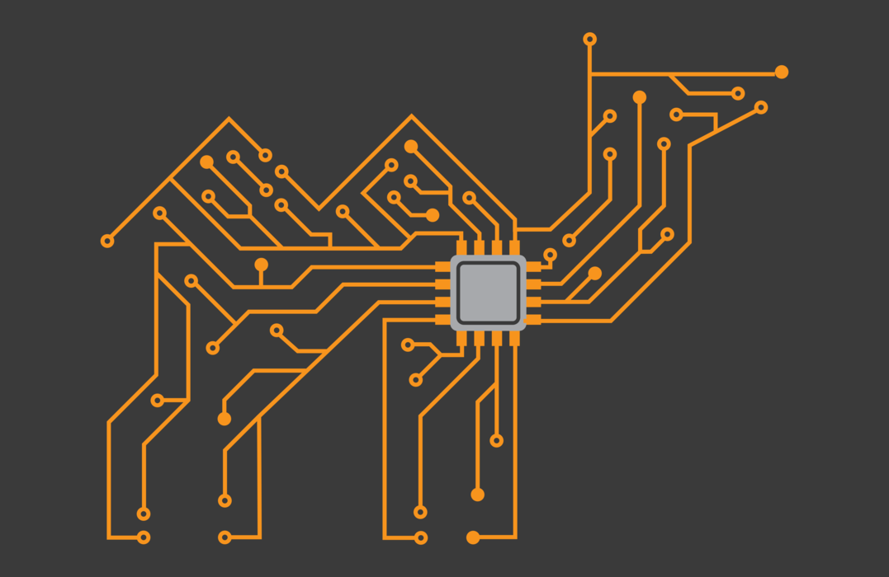

<figure style="max-width: 360px; margin: 2em auto; text-align: center;">



</figure>

*This post was written entirely by my own hand.*
*All opinions are my own and do not represent any other entities mentioned here.*

What is **[Hardcaml](https://github.com/janestreet/hardcaml/)**, and why am I so interested in it?

I encountered the [Advent of FPGA challenge](https://blog.janestreet.com/advent-of-fpga-challenge-2025/) about a year ago, but 
ultimately didn't make a submission as my internship with [Astranis](https://www.astranis.com/) was beginning. Post coming soon on that. 
Shoutout [Anish Singhani](https://github.com/asinghani) for hosting the competition!

My hardware background is in SystemVerilog and VHDL, the two standard languages for digital hardware design, and originally Hardcaml was *very* difficult for me to comprehend. 
My background software-wise is C++, Rust, and Python. Hardcaml was super new on both avenues of the functional aspect and the description granularity it represented.
The unfamiliar part wasn't the idea of a circuit, aber was thinking about a circuit as something I could construct using a functional programming language and reason about as a mathematical structure.
But what do these things even mean?

This is an introduction from that perspective: some familiarity with programming and basic digital hardware, but no OCaml knowledge assumed. It isn't a tutorial... yet. The question here is **what Hardcaml does, why I want to use it, and what makes that choice less 
straightforward than the enthusiasm might suggest.**

<figure style="max-width: 360px; margin: 2em auto; text-align: center;">


<figcaption style="font-size: 0.85em;">I don't really know why I have a ham here but I kinda want some ham right now.</figcaption>
</figure>

## The Bread, Le Beurre, and... Ham?

Hardcaml is an **[OCaml](https://ocaml.org/) library for describing and testing digital hardware**. 
OCaml is the programming language; Hardcaml gives it operations for constructing circuits.

The important distinction is that **the OCaml program runs to build a circuit description**. 
To say it's a software program that gets translated instruction-by-instruction into hardware isn't quite the right *description* (heh... get it?).

That description can be simulated, or emitted as Verilog or VHDL for conventional hardware tools to process. For an FPGA project, the broad path looks like this:

<p>
<strong>
OCaml circuit-building code →<br />
<span style="display: inline-block; padding-left: 2em;">
Hardcaml circuit description →<br />
emitted RTL →<br />
synthesis and implementation tools →<br />
FPGA
</span>
</strong>
</p>

RTL means *register-transfer level*, a description of hardware in terms of stored state and the logic operating on it. 
Synthesis turns that description into a network of hardware resources; implementation maps and connects those resources on the device.

So Hardcaml doesn't require Vivado to understand OCaml; it produces a hardware description that Vivado can consume.

This also isn't a promise that an arbitrary software algorithm becomes an efficient circuit automatically. 
You still get to decide what is parallel, where state lives, and how data moves between clock cycles. 
Hardcaml changes how you **express and construct** that architecture... but you still have to design it.

That is the mental shift that took me a while: the software constructing the hardware and the behavior of the resulting hardware are two different things.
You really have to think about the language itself a bit more, as there's simply more to do with it. A small set of SystemVerilog structures 
constitutes the vast majority of what you'll be doing, while the range of constructs available in Hardcaml, I would argue, is much, *much* greater.

## In Action;

Let's start with a small example. Suppose I have a list of input signals, and I want to apply the same hardware operation to each one.

In OCaml, a function can be passed to another function as an argument. A function that accepts or returns functions is called a **higher-order function**. 
Here, `apply_to_all` accepts an operation and uses `List.map` to apply it to every input:

```ocaml
open Hardcaml
open Signal

let apply_to_all operation inputs =
  Stdlib.List.map operation inputs

let increment_all inputs =
  apply_to_all (fun x -> x +:. 1) inputs

let invert_all inputs =
  apply_to_all (fun x -> ~:x) inputs

let double_all inputs =
  apply_to_all (fun x -> x +: x) inputs
```

You don't need to memorize the syntax. `fun x -> ...` defines an anonymous function; the three operations describe incrementing a signal, inverting its bits, and adding it to itself. `+:.` adds an integer constant to a signal, while `+:` adds two signals.
The other thing you might notice is that this looks nothing like hardware. That's both a strength and a weakness of Hardcaml.

The bridge exists in things like `Signal.t` values: descriptions of hardware signals, **not ordinary integers containing their current simulated values**.

During **elaboration** - running the code that constructs the circuit - OCaml walks the list and builds the corresponding 
operations in Hardcaml's circuit graph. That graph records the operations and their connections.

For eight 32-bit inputs, `increment_all` describes eight independent 32-bit increments. 
It does **not** describe a processor looping through eight values over eight clock cycles. There is no clock or register in this example. 
It describes combinational logic, whose outputs depend on its current inputs. The arithmetic results stay at the input width, so overflow is discarded.

The list traversal happens while constructing the circuit. It isn't itself hardware that needs to execute on the FPGA. Sometimes I forget this, and it takes
a nice Factorio session to drive `Cerveau.rst_n <--. 0;`.

For readers familiar with SystemVerilog, a hand-written equivalent of the *incrementing behavior* might look like this:


```verilog
module vector_increment #(
  parameter int N = 8,
  parameter int W = 32
)(
  input  logic [W-1:0] data_in  [N],
  output logic [W-1:0] data_out [N]
);

for (genvar i = 0; i < N; i++) begin : gen_inc
  assign data_out[i] = data_in[i] + 1'b1;
end

endmodule
```

SystemVerilog can absolutely express this, and its `generate` loop also expands during elaboration rather than iterating over clock cycles. It supports synthesizable functions too, 
but present more than (1) or (2) functions you intend to synthesize to an industry hardware engineer, and they'll look 
at you as Heracles à l'[hydre](https://en.wikipedia.org/wiki/Lernaean_Hydra) (many heads).
Neither repetition nor arithmetic acts as an exclusive selling point here; instead, **composition** and **integration** act as the driving factors.

What I particularly like is the *expressiveness* and *composability* of the language. The ability to write intermediate helper functions is such a nice feature, 
compared to SystemVerilog, where the module itself is the standard unit of composition.
The same traversal can build increments, inversions, or something more involved without modifying the traversal itself. And don't get me started on **verification**. 
A post for another time, but verification is where a language like Hardcaml shines.

The little example isn't shorter by some revolutionary amount, but imagine the possibilities as the operations grow...

## The Addiction Begins

The appeal is having the *programming* language available while constructing hardware.

With Hardcaml, I can think about an operation independently of how I apply it across a collection of signals. 
Functions can build smaller circuit fragments, and other functions can combine those fragments into a larger design. 
That lets the organization of the source reflect the ideas used to construct the circuit, rather than only its final wiring.

SystemVerilog has its own tools for abstraction and reuse... but look at my options. **[UVM](https://en.wikipedia.org/wiki/Universal_Verification_Methodology)**?
I've written more than my fair share of UVM. I can safely say it was one of the hardest engineering frameworks to wrap my head around, and, in retrospect,
it was one of the driving factors behind my adoption of Hardcaml: it is a software framework disguised as a hardware library. Now, duh, it's not a synthesizable language,
and we're not here to rag on UVM; SystemVerilog's origins as a hardware description language are at odds with the software-style abstractions UVM relies on. For simplicity, let's consider the verification suite of Hardcaml
as the "functional" approach to UVM.

My preference here isn't based on any inability of SystemVerilog to describe the same hardware. It's about finding OCaml's function-based approach 
compelling for writing **reusable circuit generators**, and better yet, *testing them*.

Testing is the largest part of the appeal. Hardcaml includes [simulation facilities](https://github.com/janestreet/hardcaml), and the 
surrounding ecosystem includes [waveform rendering](https://github.com/janestreet/hardcaml_waveterm) and [formal verification tools](https://github.com/janestreet/hardcaml_verify). 
Shoutout TUI-based waveforms. Probably in my top (3) coolest things that I never knew I wanted, right behind **[Bazel](https://bazel.build/)** as a whole, and my own intern - 
shoutout Vignesh.
Verification means checking whether a circuit behaves as intended. It's a whole lot more than the nonsynthesizable remainder of a language.

The circuit description and its tests can live in the same programming environment, even though they do different jobs. 
Circuit-building code constructs the hardware; test code supplies inputs and checks behavior.
That doesn't make verification automatic, but it's a useful way to organize the work. The drawback is that there are **no** public examples
of good Hardcaml-based verification suites. My own suites exist as an amalgam of UVM-related shenanigans and expect tests. See **[this](https://github.com/bopurtell/hardcaml_networking/pull/27)**. 

Warning: comments are quite explicit in some places.

<div class="wide-code">

```ocaml
let create ~f ~enable ~arity spec args =
  let enable =
    let pipeline_depth = ceil_log ~base:arity (List.length args) in
    Signal.pipeline ~n:pipeline_depth ~enable:Signal.vdd spec enable
  in
  { With_valid.valid = enable
  ; value =
      Signal.tree
        ~arity
        ~f:(fun l -> Signal.reg ~enable:Signal.vdd spec (Signal.reduce l ~f))
        args
  }
;;
```
</div>

Here is another example, taken from some [publicly available libraries](https://github.com/janestreet/hardcaml_circuits/blob/master/src/pipelined_tree_reduce.ml). It's so different from standard SV, but lets you exercise
the __tree__ function in Hardcaml to the max.

The enthusiasm isn't that I can stop thinking about hardware. It's that I get a richer set of software tools for expressing the hardware I mean.

And that's **AWESOME**. Just like chicken tenders.

<figure style="max-width: 360px; margin: 2em auto; text-align: center;">


<figcaption style="font-size: 0.85em;">Tenders, the UF campus cat.</figcaption>

This is the face that I make when I have to write SystemVerilog.
</figure>

## Linguistic Quirks and Practical Trade-offs

The obvious question is: **why would I use it over SystemVerilog?**

The answer? You wouldn't. Unless you are a member of the set
*S* = {mentally ill people} ∪ {Jane Street devs}, there's
absolutely no reason to use this.

That's obviously an overstatement, but there are a *few* barriers to Hardcaml adoption.

I do love a good rabbit hole.

Premièrement, the learning curve is muito real. Coming from a traditional SystemVerilog/VHDL background, I had to learn both unfamiliar OCaml syntax and a different way to organize circuit-building code. 
Functional programming treats functions as values that can be passed around and combined. That's useful here, 
but understanding the hardware doesn't mean that style will immediately feel natural.
It's like learning (2) languages at once, one of which belongs to a completely unfamiliar programming paradigm. Shoutout to Chinese (Mandarin), which was easier to learn than I thought compared to functional programming.

Second, there's workflow plumbing. One of the things I find unwieldy is the path from an OCaml circuit to a design in Vivado. 
Emitting RTL is not the same as having a complete FPGA project: the design still needs its **top-level connections, clocks, timing constraints, 
and any device-specific integration**. Those responsibilities exist with other HDLs too, but Hardcaml doesn't make them disappear. 
I have actively added to this problem with my creation of **[hardcaml_asic](https://github.com/bopurtell/hardcaml_asic)**. Proper release will come soon, pending me 
feeling like it.

One particular difficulty that's a bit annoying to contend with is the fact that Hardcaml *generates* Verilog. 

Consider the fairly trivial datapath: 

```ocaml
let create scope spec a_i b_i c_i =
  let product = a_i *: b_i in
  let sum = product +: c_i in
  let result = reg spec ~enable:vdd sum in
  result
;;
```

The generated Verilog might look like
```verilog
wire [15:0] _087;
wire [15:0] _088;
reg  [15:0] _089;

assign _087 = a_i * b_i;
assign _088 = _087 + c_i;

always @(posedge clock)
    _089 <= _088;
```

Now timing *hopefully* wouldn't fail here, but let's say it does. What the helly is _087? On light inspection, we can discern it to be an intermediate result
of the multiplication of the `a_i` and `b_i` input ports, but on a 64-channel DMA engine or a custom PCIe IP? Lord save us.

Third, there's the surrounding team and ecosystem. A generator written in OCaml introduces another language for collaborators to understand and maintain. 
Existing SystemVerilog modules, test environments, and established workflows can be good reasons not to change. Adoption costs are insane and not justifiable.

A mentor of mine once said:

> "Changing software [in smaller companies] is like turning a speedboat, but changing hardware [anywhere] is like turning a freighter." — Bradley Boccuzzi

And while originally we were talking about design specifications of a given circuit, changes to the tools used to design it tend to happen just as slowly. The same analogy applies to their "ship-handling," as we might put it here.

Finally, cleaner generator code doesn't guarantee better hardware. The eight independent increments above still describe parallel work; 
rewriting them with a higher-order function doesn't automatically share resources or add a pipeline. 
**Area, timing,** and **correctness** still depend on the architecture and the downstream tools.

If a project already fits an established SystemVerilog flow, staying there may be the sensible choice. 
Being different isn't enough for a tool like Hardcaml to gain adoption. It needs to earn its place by *what* it makes easier to express, test, or maintain.
I think I'm reading too many GPT-generated posts. That sounds very sloppy to me.

## The Elephant in the Car: Jane Street;

The name that comes up repeatedly around Hardcaml is **[Jane Street](https://www.janestreet.com/)**.

For me, the relevant part isn't its recruiting reputation. It's the investment in hardware tools and their use on real problems. 
Most people are drawn to the firm because of the money, and in truth they want the social status of employment, but JS knows this and filters people who aren't 
about the mission. One such caml-head is **[Andrew Ray](https://www.youtube.com/watch?v=GJX5VbKvh90)**, the original Hardcaml goon (and its creator).
The public [ZPrize projects](https://zprize.hardcaml.com/) are a concrete example, and 
Andrew Ray's [Signals and Threads interview](https://signalsandthreads.com/programmable-hardware/) gives background on Hardcaml's development and use at Jane Street.

From my perspective, JS exists as a **tech firm** more than a **trading firm**, and their technology happens to apply to trading systems.

That is a reason to take the tool seriously, not proof that every problem I encounter will already have been solved. Nor does it mean other hardware languages lack production users. It means there are substantial examples to study beyond a neat language demonstration.

The history deserves its own discussion. For this introduction, however, the important point is that Hardcaml comes with both a way to construct circuits and an ecosystem for doing something useful with them.

## Proxime

Hardcaml interests me because it lets me organize hardware construction using ordinary OCaml functions and abstractions, while still making explicit architectural decisions.

The cost is learning that environment and fitting it into a hardware workflow. In the world of engineering, that's a trade-off, not a universal upgrade over the standard. Now we just have to calibrate the cost function.

This post is the **what and why**. A separate tutorial series can tackle the **how**: building a small circuit, simulating it, and 
getting the generated RTL into an FPGA project. The distinction to carry into that series is simple: **OCaml runs to construct the circuit; 
the circuit then has its own hardware behavior.**

More to come on a series of tools that I've been hard at work on to make the ecosystem more accessible. With the coming hardware renaissance, Hardcaml is in the perfect spot for hobbyist use.

<figure style="max-width: 225px; margin: 2em auto; text-align: center;">


</figure>
